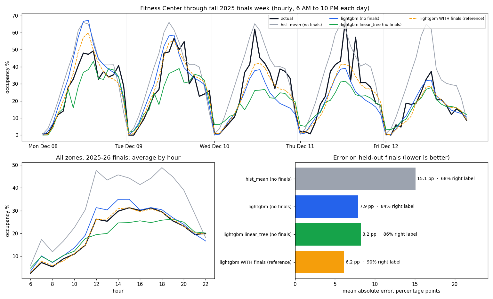

# Held-out finals test

Trained on 2023-24, 2024-25 with all finals days removed (171,489 rows, max academic_stress 0.72). Tested on the 2025-26 finals (3,810 open zone-hours, academic_stress 0.95 to 1.00). The model never sees the week_type label.

|  | mae_pp | bias_pp | status_acc |
|---|---|---|---|
| hist_mean (no finals) | 15.08 | 12.97 | 0.681 |
| lightgbm (no finals) | 7.92 | 2.17 | 0.841 |
| lightgbm linear_tree (no finals) | 8.22 | -1.59 | 0.855 |
| lightgbm WITH finals (reference) | 6.16 | 0.15 | 0.895 |

